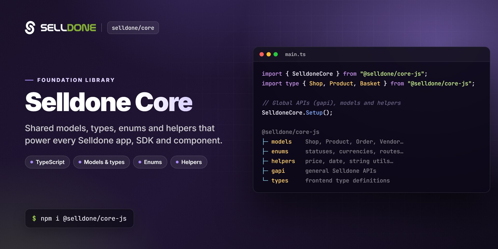

<p align="center">
  
</p>

<p align="center">
  <a href="https://www.npmjs.com/package/@selldone/core-js"></a>
  <a href="https://www.npmjs.com/package/@selldone/core-js"></a>
  <a href="LICENSE.md"></a>
  <a href="https://app.codacy.com/gh/selldone/core/dashboard?utm_source=gh&utm_medium=referral&utm_content=&utm_campaign=Badge_grade"></a>
  <a href="https://github.com/selldone/core/wiki"></a>
  <a href="https://selldone.com"></a>
</p>

<p align="center">
  <b>The foundation TypeScript library of Selldone: typed models, enums, helpers and the API base classes shared by every storefront, dashboard, SDK and component.</b><br>
  <a href="https://github.com/selldone/core/wiki">Documentation</a> ·
  <a href="#quick-start">Quick start</a> ·
  <a href="https://github.com/selldone">Ecosystem</a> ·
  <a href="https://selldone.com">Selldone.com</a> ·
  <a href="https://github.com/selldone/core/issues">Report an issue</a>
</p>

<p align="center">
  <a href="https://github.com/selldone/storefront">Storefront</a> ·
  <a href="https://github.com/selldone/pagebuilder">Page Builder</a> ·
  <a href="https://github.com/selldone/components">Components</a> ·
  <a href="https://github.com/selldone/storefront-sdk">Storefront SDK</a> ·
  <a href="https://github.com/selldone/backoffice-sdk">Backoffice SDK</a> ·
  <a href="https://github.com/selldone/vendor-sdk">Vendor SDK</a> ·
  <a href="https://github.com/selldone/community-sdk">Community SDK</a> ·
  <b><a href="https://github.com/selldone/core">Core</a></b> ·
  <a href="https://github.com/selldone/cli">CLI</a> ·
  <a href="https://github.com/selldone/translate">Translate</a>
</p>

## Overview

**Selldone® Core** (`@selldone/core-js`) is the foundational JavaScript/TypeScript library of **Selldone Business OS**. It defines the shared language of the platform: typed models for shops, products, orders, customers and vendors; enums for currencies, languages, product types and routes; helpers for prices, dates, URLs and local storage; and the HTTP base class (`APIAbstract`) with caching that all Selldone SDKs extend.

Every other front-end package builds on it. The [Storefront SDK](https://github.com/selldone/storefront-sdk), [Backoffice SDK](https://github.com/selldone/backoffice-sdk), [Vendor SDK](https://github.com/selldone/vendor-sdk), [Community SDK](https://github.com/selldone/community-sdk), [Components](https://github.com/selldone/components), the [Page Builder](https://github.com/selldone/pagebuilder) and the [Storefront](https://github.com/selldone/storefront) app all import their types and utilities from here.

Use it directly when you build an app for both storefront and backoffice, write your own Selldone API client, or simply need correct TypeScript types and helpers for Selldone data.

## Key features

- **Typed models** (`models/`) — about 100 classes and interfaces for shops, products, variants, categories, baskets, bills, customers, users, vendors, incentives, logistics, articles and community, documented against their backend source fields.
- **Enums and catalogs** (`enums/`) — 153 currencies with formatting rules, 99 languages with locale and direction, product and order types, transaction statuses, permissions, business models and the route names of the Storefront, Backoffice and Community apps.
- **Helpers** (`helper/`) — price and exchange-rate calculations, currency formatting, relative dates, Persian/Arabic digit conversion, shop and product URLs, local-storage keys, CSV import formats, SEO scoring, an LRU cache and more.
- **API base class** (`server/APIAbstract`) — GET/POST/PUT/DELETE helpers with response caching (`optimize`, `cache`), forced refresh and request cancellation.
- **Runtime services** (`server/`) — `SetupService` reads configuration from meta tags; `CDN`, `URLS` and `GAPI` build media and API URLs.
- **General API client** (`gapi/`) — `window.$selldone.gapi`, for example `fetchCountries()`.
- **Utilities** (`utils/`) — cookies, styled console output (`console.style`), slugify, debounced search, file, scroll and theme helpers, service-worker registration.
- **Prototype extensions** (`prototypes/`) — handy methods such as `Array.prototype.limit`, `sumByKey`, `uniqueByKey`, and `String.prototype.ellipsis`.
- **Analytics time series** (`timeserie/`) — `TimeSeries` turns daily statistics into today, yesterday, weekly and monthly views and chart datasets.

## Quick start

**1. Install**

```bash
npm install @selldone/core-js
```

```bash
yarn add @selldone/core-js
```

The package entry point is the TypeScript source (`index.ts`), and some enums import image assets (`.svg`, `.png`). Use a bundler that handles both, such as [Vite](https://vitejs.dev).

**2. Add the meta tags** that Selldone Core reads at start-up (shown with the public Selldone endpoints):

```html
<meta content="https://selldone.com" name="service-url">
<meta content="https://gapi.selldone.com" name="selldone-gapi">
<meta content="https://iframe.selldone.com" name="selldone-iframe">
<meta content="https://selldone.com/cdn-shop-images-1" name="selldone-cdn-images">
<meta content="https://selldone.com/cdn-shop-jsons-1" name="selldone-cdn-jsons">
<meta content="https://selldone.com/cdn-ar" name="selldone-cdn-ar">
```

**3. Set up**

```javascript
import { SelldoneCore } from "@selldone/core-js";

SelldoneCore.Setup();
```

To let Core helpers (validation rules, address formatting…) translate their messages, pass your i18n instance:

```javascript
SelldoneCore.Setup({ i18n: i18n.global }); // e.g. a vue-i18n instance
```

`Setup()` configures `window.axios` (CORS and CSRF headers), creates `window.CDN`, `window.URLS`, `window.GAPI`, `window.$selldone.gapi` and `window.$cookies`, and stores the i18n instance as `window.$i18n_global`. If you use the [Storefront SDK](https://github.com/selldone/storefront-sdk), `StorefrontSDK.Setup()` calls it for you.

## Usage

### Import paths

The package root re-exports `SelldoneCore`, `helper/`, `models/`, `server/`, `utils/` and `prototypes/`. Enums, `gapi/`, `timeserie/` and `types/` are imported by path:

```typescript
import { SelldoneCore, PriceHelper, DateConverter, ShopURLs } from "@selldone/core-js";
import type { Shop, Product, Basket } from "@selldone/core-js";

import { Currency } from "@selldone/core-js/enums/payment/Currency";
import { Language } from "@selldone/core-js/enums/language/Language";
import { StorefrontRoutesName } from "@selldone/core-js/enums/route/StorefrontRoutesName";
import { TimeSeries } from "@selldone/core-js/timeserie/TimeSeries";
```

Importing the package root also installs the prototype extensions (for example `Array.prototype.limit` and `Date.prototype.addDays`).

### Models and enums

```typescript
import { Product, Customer } from "@selldone/core-js";
import { Currency } from "@selldone/core-js/enums/payment/Currency";

Product.ProductType.PHYSICAL;  // "PHYSICAL"
Customer.Source.CUSTOMER;      // "customer"
Currency.EUR.unicode;          // "€"
Currency.USD.floats;           // 2
```

### Prices and currencies

```typescript
import { PriceHelper, CurrencyHelper } from "@selldone/core-js";

// Final price of a product (and variant) in the customer's currency,
// using the exchange rates in shop.shop_exchange_rates
const price = PriceHelper.priceProductByCurrency(shop, product, variant, "EUR");

CurrencyHelper.ConvertToString(100.5, "USD");          // "$100.50"
CurrencyHelper.ConvertToString(100.5, "EUR", "de-DE"); // "100,50 €"
```

### Dates, numbers and URLs

```typescript
import { DateConverter, NumberHelper, ShopURLs } from "@selldone/core-js";

DateConverter.getFromNowString(order.created_at, "en-US"); // e.g. "3 days ago"
NumberHelper.toEnglishNumber("۲۵.۵");                      // 25.5
ShopURLs.GetProductLink(shop, product.id);                 // full product URL of the shop
```

### General API (GAPI)

```typescript
window.$selldone.gapi
  .fetchCountries()
  .then((countries) => console.log(countries)); // [{ name, alpha2, alpha3, numeric, currency }]
```

### Build your own API client

`APIAbstract` gives your class the same request helpers and cache as the official SDKs:

```typescript
import { APIAbstract } from "@selldone/core-js";

export class MyCatalogApi extends APIAbstract {
  fetchCountries() {
    return this.getNow<{ name: string; alpha2: string }[]>(window.GAPI.GET_COUNTRIES());
  }
}
```

```javascript
const api = new MyCatalogApi();

api
  .optimize(300)   // reuse a stored response for up to 5 minutes
  .fetchCountries()
  .cache(render)   // render stored data at once and store the fresh response
  .then(render);
```

Responses are stored only for requests chained with `.cache()`, so use it together with `optimize()`. `force()` and `cancellation()` are also available. See [Server and APIs](https://github.com/selldone/core/wiki/Server-and-APIs).

### Repository layout

| Folder | Contents |
|---|---|
| [`models/`](models) | Shop, product, order, customer, user, vendor, incentive, logistic, article and community models. |
| [`enums/`](enums) | Currencies, languages, product/order types, permissions, routes, statuses and other catalogs. |
| [`helper/`](helper) | Price, currency, date, number, URL, local-storage, CSV, SEO, color, map and more. |
| [`server/`](server) | `SetupService`, `APIAbstract`, `CDN`, `URLS`, `GAPI`. |
| [`gapi/`](gapi) | `Gapi` client (`window.$selldone.gapi`). |
| [`utils/`](utils) | Cookie, console style, slugify, threads, file, scroll, theme, image, service worker. |
| [`prototypes/`](prototypes) | Array, String, Number, Object and Element extensions. |
| [`timeserie/`](timeserie) | `TimeSeries` analytics helper. |
| [`types/`](types) | Shared type definitions (route return type, file upload response, asset modules). |
| [`assets/`](assets) | Icons and images used by enums and helpers. |

## Documentation

| Page | What you'll learn |
|---|---|
| [Home](https://github.com/selldone/core/wiki) | What Selldone Core is, page map and where it fits. |
| [Getting Started](https://github.com/selldone/core/wiki/Getting-Started) | Install, meta tags, `SelldoneCore.Setup()`, import paths. |
| [Models and Types](https://github.com/selldone/core/wiki/Models-and-Types) | How models are organized, namespaces, and the most-used models. |
| [Enums](https://github.com/selldone/core/wiki/Enums) | Currencies, languages, product and order types, route names and other catalogs. |
| [Helpers and Utilities](https://github.com/selldone/core/wiki/Helpers-and-Utilities) | Helpers, utils, prototypes and `TimeSeries`, with examples. |
| [Server and APIs](https://github.com/selldone/core/wiki/Server-and-APIs) | `SetupService`, `CDN`, `URLS`, `GAPI`, `APIAbstract` caching, and `Gapi`. |
| [FAQ](https://github.com/selldone/core/wiki/FAQ) | Common questions and troubleshooting. |

## How it fits in the ecosystem

Selldone Core sits at the bottom of the Selldone front-end stack. The SDKs extend its `APIAbstract` class and return its models, the Components and Page Builder render its models with its helpers, and the Storefront app ties them together. Keeping these definitions in one package means a product, a basket or a currency looks the same everywhere.

<p align="center">
  <a href="https://github.com/selldone#ecosystem"></a>
</p>

### Related projects

| Project | Why it is relevant |
|---|---|
| [storefront-sdk](https://github.com/selldone/storefront-sdk) | Customer-facing API client built on Core (`window.$storefront`). |
| [backoffice-sdk](https://github.com/selldone/backoffice-sdk) | Admin API client built on Core (`window.$backoffice`). |
| [components](https://github.com/selldone/components) | Vue 3 commerce components that render Core models. |
| [storefront](https://github.com/selldone/storefront) | Production Vue 3 storefront that uses Core end to end. |
| [community-sdk](https://github.com/selldone/community-sdk) | Community API client that uses Core's community models. |
| [translate](https://github.com/selldone/translate) | Translation files for the i18n keys used by Core enums. |

## Contributing

Contributions are welcome. Please read the organization [contributing guide](https://github.com/selldone/.github/blob/main/CONTRIBUTING.md) and [code of conduct](https://github.com/selldone/.github/blob/main/CODE_OF_CONDUCT.md). If you find a bug or have a feature request, please open an issue; to contribute code, fork the repository and submit a pull request.

Development notes:

- `npm run build` compiles the TypeScript sources with `tsc -p tsconfig.json`; `npm run clean` removes the build output.
- Every push to `main` triggers the [`npm-publish`](.github/workflows/npm-publish.yml) workflow, which builds the package and publishes it to npm, so keep `main` releasable and bump the version in `package.json` for each release.
- Many packages depend on Core. Keep model and enum changes backward compatible, and document fields with their backend source as the existing models do.

## Security

Please do not report security vulnerabilities in public issues. Read this repository's [security policy](SECURITY.md) and email **security@selldone.com**.

## License

See [LICENSE.md](LICENSE.md) for this repository's license file.

<details>
<summary>Selldone Ecosystem License Agreement</summary>

**Selldone Ecosystem License Agreement**

1. **Scope of License**: This license is granted exclusively for the use of the enclosed code (hereinafter referred to as "the Code") within the Selldone ecosystem. The licensee is authorized to use the Code solely in conjunction with services and applications that are part of, or directly related to, the Selldone ecosystem.

2. **Commercial Use Restriction**: The licensee is strictly prohibited from using the Code for any commercial purposes outside the Selldone ecosystem. Commercial utilization is permissible only when it is within the Selldone ecosystem and in accordance with the terms of this agreement.

3. **Permission for Free Use**: The Code may be used for non-commercial, free services, provided that explicit credit is given to Selldone. This credit must include the name "Selldone" prominently displayed on the user interface of the relevant service or application, along with a hyperlink to [selldone.com](https://selldone.com).

4. **No Redistribution**: The licensee may not redistribute the Code, in whole or in part, to any third party outside the Selldone ecosystem, unless expressly authorized by Selldone.

5. **No Modification for Redistribution**: While modifications to the Code for personal or internal use within the Selldone ecosystem are allowed, the licensee may not modify the Code for the purpose of redistribution outside the Selldone ecosystem.

6. **Termination**: Failure to comply with the terms of this agreement will result in the immediate termination of the license and may subject the licensee to legal action.

7. **Disclaimer of Warranty**: The Code is provided "as is" without any warranties of any kind, either expressed or implied, including but not limited to implied warranties of merchantability or fitness for a particular purpose.

8. **Limitation of Liability**: In no event shall Selldone be liable for any damages arising out of the use or inability to use the Code.

9. **Jurisdiction and Disputes**: This agreement shall be governed by the laws of the jurisdiction where Selldone is established. Any disputes arising from this agreement shall be resolved in the courts of that jurisdiction.

By using the Code, the licensee acknowledges that they have read, understood, and agreed to the terms of this license.

</details>

---
<p align="center"><sub>Part of the <a href="https://github.com/selldone">Selldone® Business OS</a> open-source ecosystem · <a href="https://selldone.com">selldone.com</a></sub></p>
